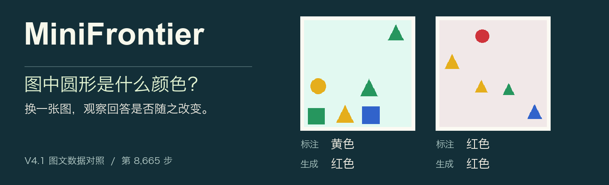

# MiniFrontier

用 PyTorch 学习小型语言模型和多模态模型的训练。你可以从一条图文样本出发，查看它怎样变成 token、哪些位置参与计算损失，再从检查点生成回答。仓库有六个模型版本，共用实验工具，也保留各自的架构实现。

[从一个实验开始](docs/guides/learning-path.md) · [模型结构](#模型家族) · [实验记录](docs/experiments.md) · [文档索引](docs/README.md)

## 快速开始

在 Linux 和 Python 3.11+ 环境安装 [uv](https://docs.astral.sh/uv/getting-started/installation/)，运行下面的 MF1.0 教学实验。数据由本地程序生成，使用 CPU 即可完成。

```bash
git clone https://github.com/576469377/MiniFrontier.git
cd MiniFrontier
uv sync --locked --extra dev
CUDA_VISIBLE_DEVICES='' OMP_NUM_THREADS=2 MINIFRONTIER_MIN_FREE_GIB=1 \
  uv run minifrontier mf1 quickstart --model-version 1.0 \
    --device cpu --output outputs/mf1-quickstart
```

打开 `outputs/mf1-quickstart/report.json` 查看各阶段、更新次数和保存的检查点。再给刚训练的权重一张图片，看看它生成了什么。

```bash
uv run minifrontier mf1 generate \
  --checkpoint outputs/mf1-quickstart/sft/checkpoint.pt \
  --prompt 'Color?' --image outputs/mf1-quickstart/data/media/train-32-0.png \
  --max-new-tokens 12 --temperature 0 --device cpu
```

这张图来自训练集。要检验模型能否识别新图，可按学习路线换用留出集、固定问题并交换两张图。重复运行 quickstart 时使用新的输出目录。[学习路线](docs/guides/learning-path.md) · [MF1 训练与导出](docs/guides/minifrontier1.md)

## 模型家族

| 模型与结构图 | 研究配置参数量 | 可以研究什么 |
|---|---:|---|
| [MiniFrontier1.0](docs/models/minifrontier1.md) | 228M | 递推注意力、压缩历史、稀疏检索与多 token 预测怎样组合 |
| [MiniFrontier1.1](docs/models/minifrontier11.md) | 211M | 更换残差连接并关闭主干多 token 预测后，模型如何传递信息 |
| [MiniDeepSeek-V4](docs/models/minideepseekv4.md) | 244M | 滑动窗口与压缩注意力怎样共用上下文 |
| [MiniDeepSeek-V4.1](docs/models/minideepseekv41.md) | 242M 文本主干 | 跨层共享读取，以及接入视觉编码器后的图文生成 |
| [MiniQwen4](docs/models/miniqwen4.md) | 513M | 递推网络、稀疏注意力与专家路由如何分工 |
| [MiniKimi-K3](docs/models/minikimik3.md) | 205M | KDA、MLA 与潜在空间专家怎样处理长序列 |

参数量按各页所列研究配置统计。MF1.0 和 MF1.1 是本项目的组合架构；其余四项给出上游出处与本地缩比实现。MiniQwen4 沿用参考源码的 `qwen4_exp` 命名。[配置目录](configs) · [上游代码与模型来源](THIRD_PARTY_NOTICES.md)

## 训练效果怎样看

封面来自一次 V4.1 留出集实验。新旧两份数据从相同检查点各训练 415 次更新。新数据分支在正确图片上答对 14/180 道短答题，同题换成答案不同的图片后答对 18/180。封面上的黄色圆和红色圆，正是模型给出同一回答的两个样本。

沿旧数据继续训练至第 14,034 步，达到 2.50 亿监督 token。该权重在同一面板的短答为 0/180，逐行 OCR 完全正确为 0/80。学习路线给出了评测口径，以及怎样把训练损失、回答格式和看图能力分开测量。[实验与读数](docs/guides/learning-path.md#看图时模型用了什么) · [其他实验](docs/experiments.md)

## 开发与引用

[代码目录](docs/architecture.md) · [贡献指南](CONTRIBUTING.md) · [引用信息](CITATION.cff) · [代码许可](LICENSE) · [上游代码与数据许可](THIRD_PARTY_NOTICES.md)
